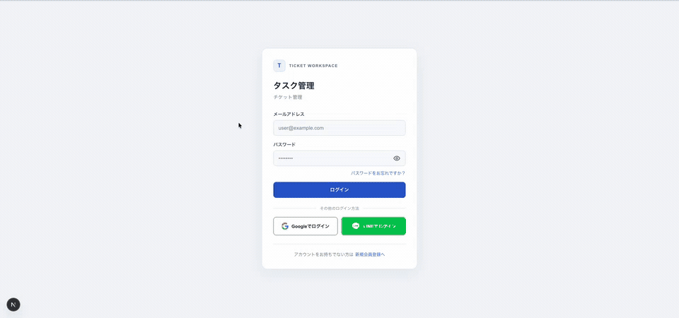

# jihoon-projects

Vue.jsを中心としたフロントエンド実務の経験を土台に、現場で得たReact・Laravelの経験も活かして制作した個人プロジェクトを紹介しています。メインのチケット管理アプリ **Ticket** では、設計から実装・テストまで取り組み、権限管理や状態同期などを実装しました。生成AIを活用した開発プロセスの設計・改善も紹介しています。

メインプロジェクトは、社内利用を想定した業務アプリ **Ticket** です。チケット管理に加え、出勤・退勤の記録と本人の勤務履歴を扱う勤怠機能を備えています。

## メインプロジェクト：Ticket

**個人開発 / React・Next.js + Laravel** — チケット管理の基本操作に加え、認証・認可、APIとの状態同期、更新競合への対応を含む業務アプリケーションです。

- Sanctumセッション認証
- プロジェクト作成、メンバー管理、閲覧・編集権限
- チケットの作成・編集・削除、ステータスと優先度、担当者設定
- 検索、担当者フィルター、ドラッグ＆ドロップ
- コメント、プロジェクトの終了・復元
- 出勤・退勤の記録、今日の状態、本人の勤務履歴と勤務時間

### Ticket操作デモ（GIF）



### 画面イメージ

| チケットボード | ログイン画面 |
| --- | --- |
| [](docs/ticket/images/ticket-board-v1.png) | [](docs/ticket/images/login-v1.png) |
| プロジェクトごとにチケットの状態・優先度・担当者を確認できます。 | メールでのログインと、登録・パスワード再設定への入口です。 |

ローカル環境で撮影した画面です。画像をクリックすると元のサイズで表示できます。

### 実装上の工夫

- **権限管理:** プロジェクト所属・閲覧／編集権限・コメント所有権をAPI側でも確認。
- **ボード操作:** チケットの状態と列内の表示順をサーバーに保存。更新時にはボードのバージョンを比較し、古い状態からの変更を競合として扱います。
- **品質確認:** 2026年10月27日にReact 57 test files / 251 tests、TypeScript、ESLint、Next.js production buildを確認しました。Laravelの全テストは、勤怠統合時のGitHub Actionsで通過しています。

[Ticketの機能別マニュアル](docs/ticket/README.md)と[勤怠機能の操作ガイド](docs/attendance/README.md)で操作方法を説明し、[Ticket開発・検証記録](docs/ticket/TICKET.md)では公開範囲、実装上の前提、過去の検証記録を説明しています。

## AIを活用した開発プロセス

AIをコード生成だけに使わず、作業範囲、検証、レビュー、統合を整理しながら開発しています。公開されたエージェント資料は [AGENTS v2.1](docs/agent/AGENTS-v2.1.md)、[WORK v2.1](docs/agent/WORK-v2.1.md)、[MANUAL v2.1](docs/agent/MANUAL-v2.1.md) に保存しています。これらは開発プロセスの公開例です。

実装内容や採用判断は人が確認し、テストと動作確認の結果をもとに変更しています。

## 技術スタック

- **フロントエンド:** Next.js、React、TypeScript、Zustand、dnd-kit
- **バックエンド:** Laravel、PHP、Laravel Sanctum、Socialite
- **品質確認:** Vitest、Testing Library、PHPUnit、ESLint、TypeScript
- **開発プロセス:** Git、AI支援開発、作業範囲と検証記録の管理

## リポジトリ構成

```text
laravel/       Laravel API、認証、DBマイグレーション、バックエンドテスト
react/         Next.jsアプリ、認証・投稿・お知らせ・Ticket UI
docs/ticket/   Ticket V1の機能別マニュアルと開発・検証記録
docs/agent/    公開エージェント構成のポートフォリオ保存例
micropython/   趣味のMicroPython・Thumby制作
vue/           Vue関連の作業領域
```

詳細な機能範囲と検証条件は [Ticket開発・検証記録](docs/ticket/TICKET.md) を参照してください。
