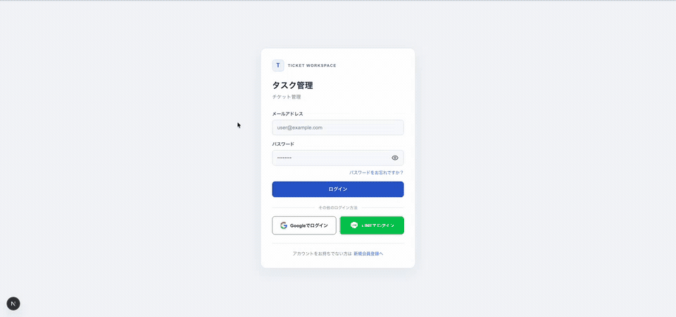
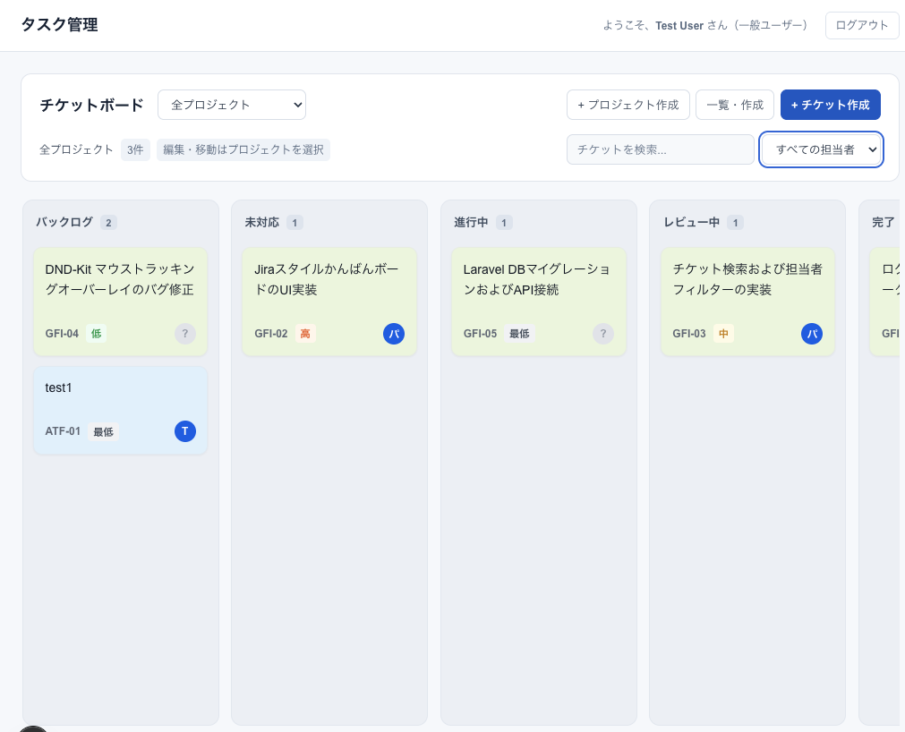
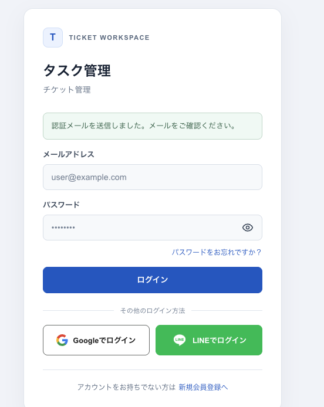

# jihoon-projects | フロントエンドエンジニア ポートフォリオ

**Vue.js / TypeScriptを主軸に、6年以上のフロントエンド実務経験。** Nuxt 2からNuxt 3への移行などを経験しました。ReactとLaravelも現場で使用しており、本ポートフォリオではNext.jsとLaravel APIを組み合わせたTicket管理アプリで、画面からAPIまでの設計・実装を紹介します。

## Ticket管理アプリ

プロジェクト、メンバー、チケットを管理するWebアプリケーションです。認証、権限管理、チケット操作、コメントまで、フロントエンドとAPIをつないだ機能を実装しています。

### 動作デモ



### 主な機能

- Sanctumによるセッション認証
- プロジェクト作成・検索・選択、メンバー管理、閲覧・編集権限
- チケットの作成・編集・削除、ステータス・優先度・担当者設定
- 検索、担当者フィルター、ドラッグ＆ドロップ
- コメントの作成・編集・削除
- プロジェクトの終了・復元

### 画面イメージ

| チケットボード | ログイン画面 |
| --- | --- |
| [](docs/ticket/images/ticket-board-v1.png) | [](docs/ticket/images/login-v1.png) |
| 状態・優先度・担当者を確認できるチケットボード | メールログインと登録・パスワード再設定画面 |

### 設計・実装のポイント

- **サーバー側の権限確認:** プロジェクト所属、閲覧・編集権限、コメント所有権をAPI側でも検証。
- **API境界でのデータ変換:** Laravelのsnake_case応答とReactの画面モデルを分離。
- **更新競合への対応:** チケットの状態と列内の並び順をサーバーに保存し、ボードのバージョンを使って古い状態からの更新を検知。
- **CSRF対策:** statefulなSPA APIでトークンなしの状態変更が拒否されることをテストで確認。

[機能別V1マニュアル](docs/ticket/README.md)に操作方法、[Ticket開発・検証記録](docs/ticket/TICKET.md)に公開範囲・設計上の前提・検証内容をまとめています。

## 経験・技術スタック

| 領域 | 経験・技術 |
| --- | --- |
| フロントエンド実務 | Vue.js / TypeScript、6年以上。Nuxt 2からNuxt 3への移行など |
| React・API連携 | React、Next.js、Laravel API、Laravel Sanctum |
| UI・状態管理 | Zustand、dnd-kit |
| テスト・品質確認 | Vitest、Testing Library、PHPUnit、ESLint、TypeScript |

## AIを活用した開発プロセス

Ticketアプリは、自分でコードを書いて実装するところから始め、開発の中でAIに任せる作業を少しずつ増やしてきました。AIの出力を自分で確認・修正し、設計判断や最終検証も行いながら、進め方を改善して生産性を高めています。現在も、コーディングとAIエージェントの両方を活用する開発に取り組んでいます。

公開版AGENTS v2.1は、実作業で使い、課題とレビューを受けて更新したルールです。WORKとMANUALは、それぞれ作業指示・引き継ぎと利用者向け完了報告に使うテンプレートです。v2.2のページでは、実際の適用履歴を公開PRと検証記録に結びつけています。

- [AGENTS v2.1](docs/agent/AGENTS-v2.1.md) — 実作業で使用した公開ルール
- [WORKテンプレート v2.1](docs/agent/WORK-v2.1.md) — 個別作業の目的・範囲・完了条件・検証を記入
- [MANUALテンプレート v2.1](docs/agent/MANUAL-v2.1.md) — 作業結果・検証・制約を利用者へ報告
- [AI Workflow v2.2](docs/agent/AI-WORKFLOW-v2.2.md) — ルールの更新経緯と後続作業の公開根拠

v2.2はポートフォリオ上の証拠整理の版であり、AGENTSのルール版はv2.1です。内部のpromptや運用設定は公開していません。

## テスト・検証実績

2026年10月27日の公開デモでは、React 257 tests、TypeScript、ESLint、Next.js静的出力に加え、Laravel全テストとPintがGitHub Actionsで通過しました。Chrome HeadlessとローカルAPIを使った画面・操作確認の記録もあります。

詳細な検証内容は[Ticket開発・検証記録](docs/ticket/TICKET.md)を参照してください。

## リポジトリ構成

```text
laravel/       Laravel API、認証、DBマイグレーション、バックエンドテスト
react/         Next.jsアプリ、認証・投稿・お知らせ・Ticket UI
docs/ticket/   Ticket V1の機能別マニュアルと開発・検証記録
docs/agent/    公開AI作業ルール、WORK・MANUALテンプレート、適用根拠
micropython/   趣味のMicroPython・Thumby制作
vue/           Vue関連の作業領域
```
