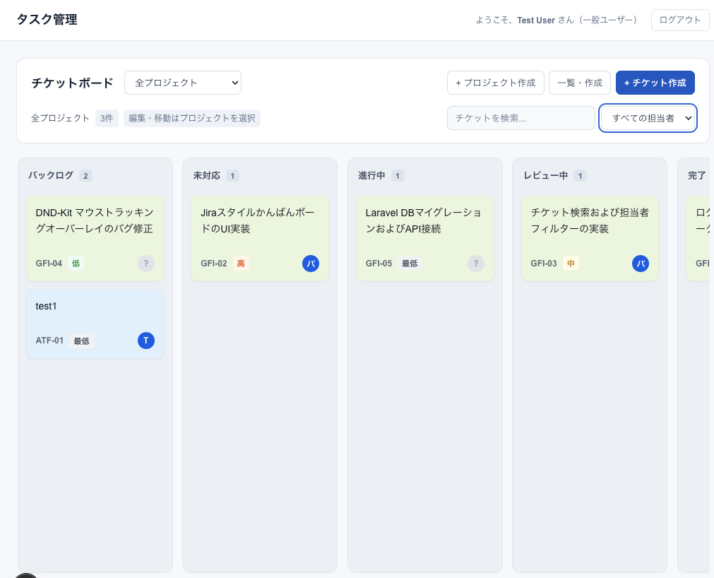
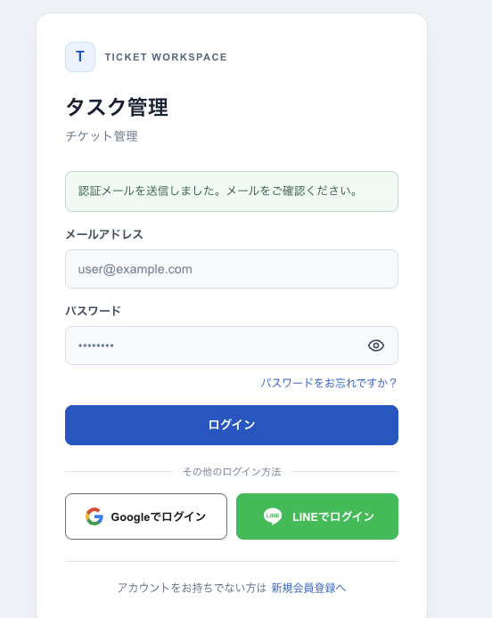

# jihoon-projects

Vueを中心としたフロントエンドの実務経験を基盤に、React / Next.js と Laravel による業務アプリケーションを個人開発しています。生成AIを実装支援に活用し、コード・テスト・動作確認で成果を検証しています。

メインプロジェクトの **Ticket** は、チーム内のタスク・担当者・進捗を共有するためのチケット管理アプリです。社内利用を目標に開発しており、このリポジトリではV1のコード、画面、利用手順、テストを公開しています。

[画面](#画面イメージ) · [設計とテスト](#実装で確認できる工夫) · [検証結果](#検証結果) · [利用マニュアル](docs/ticket/README.md) · [実行手順：React](react/README.md) / [Laravel](laravel/README.md)

## メインプロジェクト：Ticket

- Sanctumセッション認証
- プロジェクト作成、メンバー管理、閲覧・編集権限
- チケットの作成・編集・削除、ステータスと優先度、担当者設定
- 検索、担当者フィルター、ドラッグ＆ドロップ
- コメント、プロジェクトの終了・復元

### 画面イメージ

| チケットボード | ログイン画面 |
| --- | --- |
| [](docs/ticket/images/ticket-board-v1.png) | [](docs/ticket/images/login-v1.png) |
| プロジェクトごとにチケットの状態・優先度・担当者を確認できます。 | メールでのログインと、登録・パスワード再設定への入口です。 |

ローカル環境のデモ画面です。画像をクリックすると元のサイズで表示できます。

### 実装で確認できる工夫

複数人で使う際の権限変更、編集の競合、通信の遅延を想定して実装しています。

| 課題 | 実装上の対応 | 確認できるテスト |
| --- | --- | --- |
| 処理中に編集権限が取り消される | APIで所属・権限を検査し、DBロック取得後も再確認 | [権限変更時に保存を拒否する](laravel/tests/Feature/Ticket/PermissionBoundaryTest.php) |
| 古い編集内容で他の人の変更を上書きする | 編集画面から送るバージョンを更新SQLで比較し、不一致は409。ボード移動もバージョンで検査 | [同じ秒の編集・移動後の競合](laravel/tests/Feature/Ticket/EditConcurrencyTest.php) |
| 遅い応答や失敗時の復元で新しい状態が消える | 古いGETを無視し、同じチケットの書き込みを直列化。ログアウト後の応答も反映しない | [応答順序・部分復元・セッション切替](react/src/features/tickets/store/test/useTicketStore.test.ts) |

編集競合時は入力を保持して再取得を案内します。[画面のテスト](react/src/features/tickets/components/Board/TicketModal/test/freshness.test.tsx)では、再取得の失敗や権限喪失時も確認しています。APIは互換性のためバージョンなしの更新も許可しており、競合防止を全クライアントに強制する構成ではありません。

[設計・テストの具体例](docs/ticket/TICKET.md#設計とテストの具体例)から実装とテストを確認できます。操作方法は [機能別V1マニュアル](docs/ticket/README.md)、実行環境は [React](react/README.md) / [Laravel](laravel/README.md) を参照してください。

### 検証結果

公開V1はテスト・動作確認を経てmainに採用しています。採用時の確認範囲は [開発・検証記録](docs/ticket/TICKET.md#検証記録) にまとめています。

追加の自動検証として、2026-10-20、コミット `fe40e95` の [GitHub Actions](https://github.com/jihoonlabs/jihoon-projects/actions/runs/39352159731) で次を確認しました。

| フロントエンド | バックエンド |
| --- | --- |
| React 250 tests、TypeScript、ESLint、production build通過 | Laravel 158 tests・1,624 assertions通過（PHP 8.4 / SQLite） |

外部OAuth・メール実配送・本番DBでの負荷や同時実行はこのCIの対象外です。[検証範囲と再実行手順](docs/ticket/TICKET.md#自動検証と再実行)を公開しています。

## AIを活用した開発プロセス

この個人開発では、React / Laravelの実装・テスト作成・修正に生成AIを活用しています。コードをすべて手書きした作品としてではなく、AI支援を含む開発成果として公開しています。

- **自分が担うこと:** 目的・要件・公開範囲の決定、動作確認、修正方針と変更の採用判断。
- **AIに任せること:** 合意した範囲での実装案・コード・テストの作成、調査とレビューの支援。
- **品質の確認:** 生成されたコードをそのまま完成扱いせず、テスト・型検査・lint・buildと動作確認で結果を検証。成功時だけでなく、権限変更・編集競合・遅延応答などの失敗条件も確認します。

評価していただきたい点は生成量ではなく、要求を実装と検証につなげる進め方と、公開コードで確認できる動作です。過去の公開例は [AGENTS v2.1](docs/agent/AGENTS-v2.1.md)、[WORK v2.1](docs/agent/WORK-v2.1.md)、[MANUAL v2.1](docs/agent/MANUAL-v2.1.md) を参照してください。これらは保存資料であり、現在の作業指示ではありません。現在の内部運用資料は公開対象外です。

## 技術スタック

- **フロントエンド:** Next.js、React、TypeScript、Zustand、dnd-kit
- **バックエンド:** Laravel、PHP、Laravel Sanctum、Socialite
- **品質確認:** Vitest、Testing Library、PHPUnit、ESLint、TypeScript
- **開発プロセス:** Git、AI支援開発、作業範囲と検証記録の管理

## その他の制作：Thumby Brawl Base

72×40の白黒Thumby向けに、MicroPythonで1対1アクションRPGのベースを制作しています。AI支援開発を小型ゲームに適用する実験です。開発中のため、PCテストと実機での確認範囲を分けています。

概要・操作・テストは [公開マニュアル](docs/thumby-brawl-base/MANUAL.md)、コードは [Thumby Brawl Base](micropython/Thumby/ThumbyBrawlBase/) を参照してください。

## リポジトリ構成

```text
laravel/       Laravel API、認証、DBマイグレーション、バックエンドテスト
react/         Next.jsアプリ、認証・投稿・お知らせ・Ticket UI
docs/ticket/   Ticket V1の機能別マニュアルと開発・検証記録
docs/agent/    公開エージェント構成のポートフォリオ保存例
docs/thumby-brawl-base/  Thumby Brawl Baseの公開マニュアル
micropython/   Thumby向けゲームの試作
vue/           Vue用の作業領域（現在は未実装）
```

公開V1の範囲と制約は [Ticket開発・検証記録](docs/ticket/TICKET.md) にまとめています。
