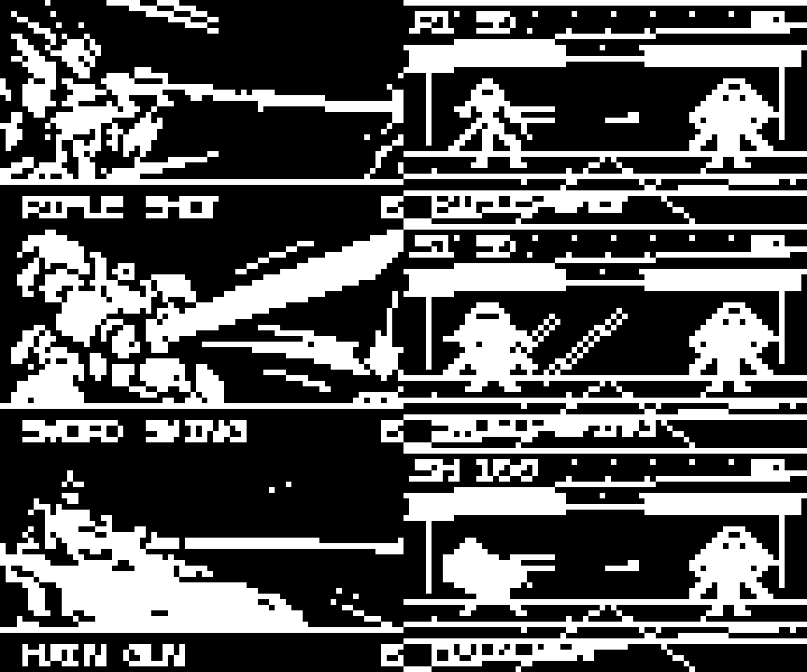

# SRPG-v1

표준 Thumby 72×40 흑백 화면용 턴제 로봇 SRPG의 첫 플레이 가능 베이스입니다.
게임보이 시대 전술 RPG처럼 작은 맵/유닛과 간결한 메뉴를 쓰고, 전투에는
전투에서는 화면을 크게 쓰는 흑백 로봇 실루엣과 무기별 공격 궤적을 사용합니다.

미선택 상태에서는 맵이 9×5 타일로 화면 전체를 사용합니다. 유닛을 선택하면
행동 메뉴와 간단한 HP 표시만 겹쳐 나오며, EN·장갑 등 상세 능력치는
`STATUS`를 선택했을 때 표시합니다.

## 컷인 미리보기

썸비의 72×40 화면을 8배로 확대했습니다. 리얼계·슈퍼계·전함 순으로,
각 줄의 왼쪽에 컷인 한 장, 오른쪽에 작은 전투 화면을 배치했습니다.



## 실행

`ThumbySRPG.py`, `rules.py`, `assets.py`를 Thumby의 `/Games/SRPG-v1/` 폴더에
함께 복사하고 `ThumbySRPG.py`를 실행합니다.

## 조작

- 방향 버튼: 맵 커서와 메뉴 이동
- A: 선택 / 확인
- B: 취소 또는 전투 연출 건너뛰기
- `MOVE`: 이동 후 행동 메뉴로 복귀
- `ATTACK`: 기체별 무기 목록에서 공격을 선택
- `STATUS`: HP·EN·장갑·운동성·이동력을 확인
- `END`: 해당 기체의 행동 종료

공격은 무기별 사거리 안에서 선택할 수 있습니다. 리얼계는 발칸·빔 사벨·빔 건과
기체 고유 필살 무장 1개, 슈퍼계는 기본 무기 3개와 초필살기·진초필살기로
구성됩니다. 일반 무기는 컷인 없이 큰 전투 화면에서 총탄·빔·칼 공격으로 이어지고,
필살 무장만 기존 흑백 만화 컷인을 먼저 보여줍니다. EN은 현재 표시만 하며 소모
규칙은 아직 정하지 않았습니다.

## 초안 범위

- 아군은 리얼계 3기, 슈퍼계 3기, 전함 1척이며 첫 미션의 적은 8기입니다.
  전함은 기지 타일에 고정되고 HP가 기지 방어력과 연결됩니다.
- `REAL`은 날렵한 사격형, `SUPER`는 넓고 무거운 근접형, `SHIP`은 장거리 함포형입니다.
- 전투 화면은 양쪽 기체를 24×24 픽셀로 확대해 보여줍니다. 필살기 전용 컷인은
  현재 리얼계·슈퍼계·전함 유형별 초안이며, 기체별 고유 컷인은 기체 디자인을
  확정하면서 추가합니다. 필살기는 데미지가 더 큽니다.
- 전체 분량 목표는 4개 미션입니다. 현재 플레이 가능한 것은 첫 미션뿐이며,
  나머지 세 미션, 캠페인 저장, 실제 기기에서의 프레임/가독성 확인은 아직
  구현 또는 검증하지 않았습니다. 상세 규모는 [초안 문서](../../../docs/personal-game-ai/THUMBY_SRPG_V1_DRAFT.md)에 있습니다.

규칙 유닛 테스트는 저장소 루트에서 다음처럼 실행합니다.

```sh
python3 -m unittest discover -s micropython/Thumby/SRPG-v1 -p 'test_*.py' -v
```
